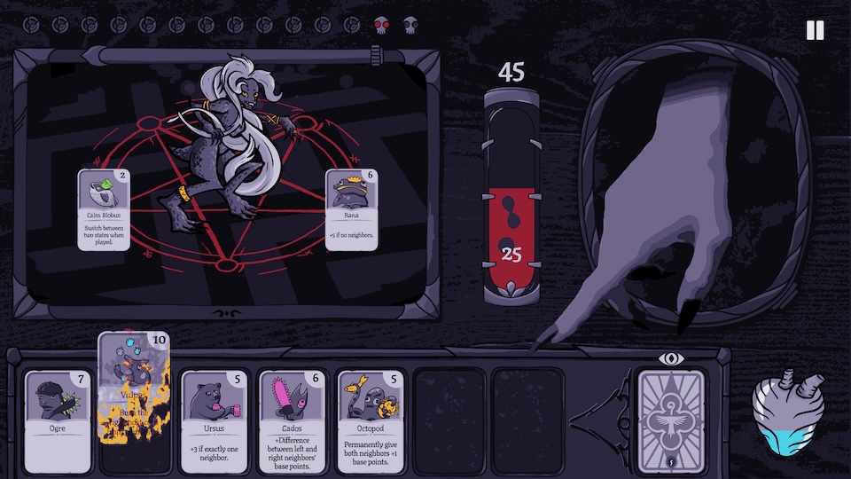
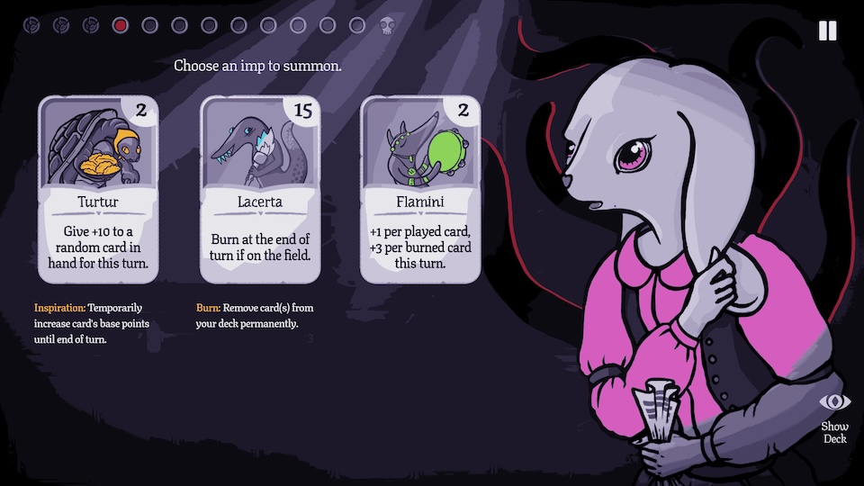
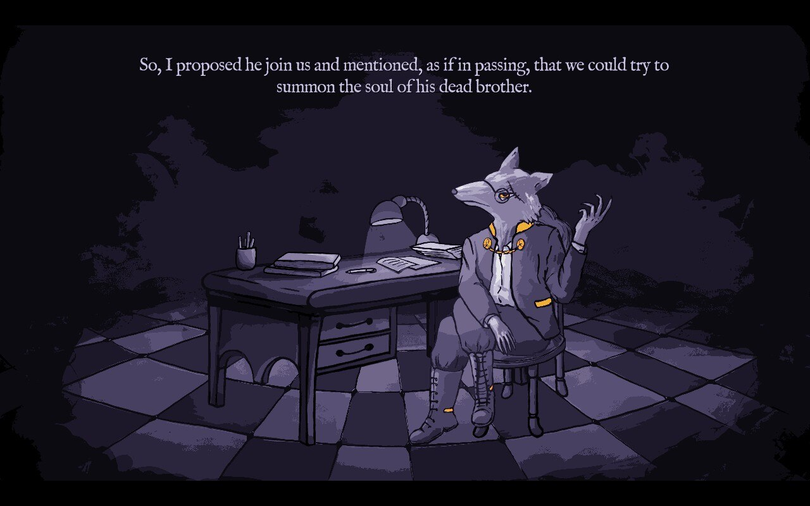

When I hear "rogue-like deckbuilder", I picture a game with infinite replayability, a huge card pool, and the thinnest veneer of a story. The newly released _Burn With Me_ eschews each of those expectations with a story that concludes and just enough cards to be interesting -- and it's all the better for it.

Each one of its 6 chapters is a meditation on its central premise: lay five numbered cards on a pentagram to beat each level's minimum score, earning a new card for your trouble on your path to the chapter boss. It's a simple setup, but the whole thing is fiendishly clever. I especially appreciated its originality, small scope, and commitment to its theme.

<YoutubeEmbed youtubeId="48EwmPP8Qx0" />

## The wick

Veterans of [deckbuilding games](https://thinkygames.com/lists/best-deck-builder-games/) (like [Slay the Spire](/games/slay-the-spire/)) will find the basic setup of _Burn With Me_ familiar:

- build your deck one card at a time
- cards have a point value and (usually) an effect when played
- complete a series of battles (here, summonings) with increasingly demanding point requirements
- do your best to remove bad cards from your deck so you can more reliably draw the good ones

But using such a reductive description does its originality a disservice; there are decisions that help _Burn With Me_ stand out in a crowded field.

The most elegant bit of design is also _Burn With Me_'s central mechanic: burning cards. While most deckbuilders treat card removal as a rare reward, here it's a core piece of resource management. There's no energy or limit to the number of cards you can play on the turn. Instead, your deck itself is the resource.

At the start of each summoning, you draw cards up to your max hand size. At any time, you can draw additional cards in exchange for permanently removing a random card in your hand from your deck. Do this too often and you'll flame out early because your deck is too thin. But used strategically, burning cards is the key to a svelte deck and a strong run. Some cards even have beneficial "when burned" effects that make you much stronger if you can trigger them.

Contrary to my typical playstyle, _Burn With Me_ forced me to be less precious about losing cards. I tend to be pretty loss-averse, so I'd much rather draw a bad card than lose a good one. But because each summoning is so short (you only play 5 cards!), holding bad cards is extra punishing. Figuring out how aggressively you want to thin your deck (while potentially risking losing your best cards) is a tough line to walk.

## The wax

I liked the variety of card effects. Some cards care about the quantity or value of their neighbors (adding a spatial component to the game that's rare in this genre). Others cards permanently adjust the point values, changing the calculus for which cards are worth keeping. Some even burn cards from specific locations. This can be the most consistent way to trigger you when-burned effects or clear up space on the board to play additional cards. Playing your hand in the optimal order is always a fun little puzzle.

Between frequent card removal and permanent card modifications, your deck feels completely unique as you reach each chapter's boss. Most card games only offer basic and upgraded versions of each card. _Burn With Me_ has no such restriction, so the sky truly is the limit.

## The flame

Tying all this gameplay together is a cozy/spooky story about helping your students overcome their (literal) inner demons. It's just sinister enough without ever veering into anything scary or unsettling.

Each of the game's 6 chapters focused on a different one of these students and includes a thematic twist to the core gameplay. For example, the tightly-wound student requires you to hit an exact score (instead of a threshold) and the gambler has a dice mechanic added to their chapter.

These adjustments aren't major, but they go a long way towards keeping gameplay fresh as you progress through the game. Each chapter also has a unique card pool, so there are always new strategies to learn. And since each chapter is only ~15 battles long, nothing overstays its welcome.

If you finish the game and find yourself wanting more, each chapter also has a "hard" variant. I didn't spend much time with these because I found the normal difficulty engaging enough, but the dev mentioned that many players find hard mode more "puzzle" than "strategy", if that's your thing.

## Extinguished

_Burn With Me_'s relentless focus delivers a tightly designed rogue-like deckbuilding experience. It takes a simple foundation, adds card removal as a central mechanic, and throws in 6 unique twists to keep gameplay novel. I'm always on the lookout for fun, short, interesting games; this absolutely fits the bill.
