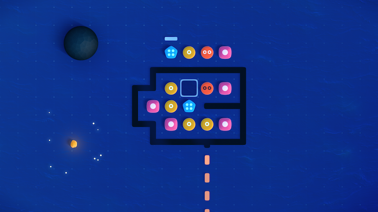
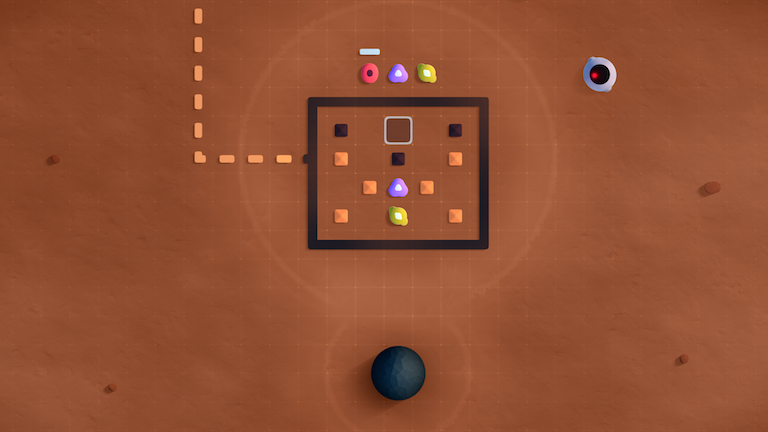
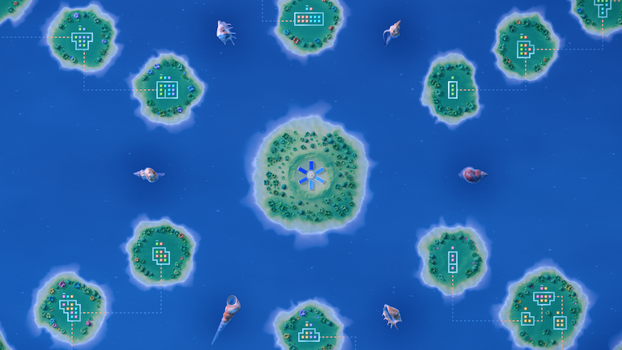

_Satelital_ is an excellent, ethereal little rule discovery game. There's no dialogue, so it's up to you to decipher the iconography and satisfy the placement requirement(s) for each tile. The overall presentation is excellent, offering exceptionally-smooth animations and not a single loading screen.

<YoutubeEmbed youtubeId="OMhObKAg7s0" />

There are 6 planets and each has its own set of tiles to figure out, so there were _plenty_ of rules to discover. Some games peter off, but no such trouble here.

I also appreciated the wide variety of rule types. They weren't just variations on a basic theme, but whole new concepts. Where [The Witness](/games/the-witness/) got a little stale eventually, _Satelital_ never had that problem.

Honestly I would have enjoyed a little more of it, but it's probably wise to leave your players wanting rather than overstaying your welcome. I especially loved the game's finale (which I won't go into detail about for fear of spoiling the experience).

Difficulty wise, everything felt just right. The levels are pretty small so there aren't _that_ many valid configurations. And when I was really stuck, a walk around the block and a fresh pair of eyes usually unblocked me.

If that doesn't work, you can always head to a different planet and focus your efforts there instead. I tend to like this approach if there aren't hints available, since I can always be doing _something_. It's part of what made [Last Call BBS](/games/last-call-bbs/) so approachable (and fellow rule discovery games [CIPHER ZERO](/games/cipher-zero/) a little more frustrating).

Outside the core gameplay, the presentation was just excellent. The UI is well thought out and communicates a lot without needing any words. Part of that is because Miguel, the developer, spent 7 years making his own game engine to power _Satelital_. Usually that's a fool's errand, but occasionally it pays off in a big way (see also: [Animal Well](/games/animal-well/))

Every animation was buttery smooth and the tiles all look positively delicious. Your actions seamlessly integrate with a dynamic soundtrack that provides atmosphere without distracting you. Coolest of all, there are no loading screens between puzzles. You can interact with everything on a planet at once or smoothly zoom out and visit another location without a single break in the motion; it's a technical marvel.

I always tell developers that their attention to detail matters more than ever right now. It's a crowded field and a polished experience helps your game stand out among competitors. _Satelital_ proves this point exactly: it doesn't tread any truly _new_ ground, but everything it does it executes perfectly. It was an absolute delight, from start to triumphant finish.
