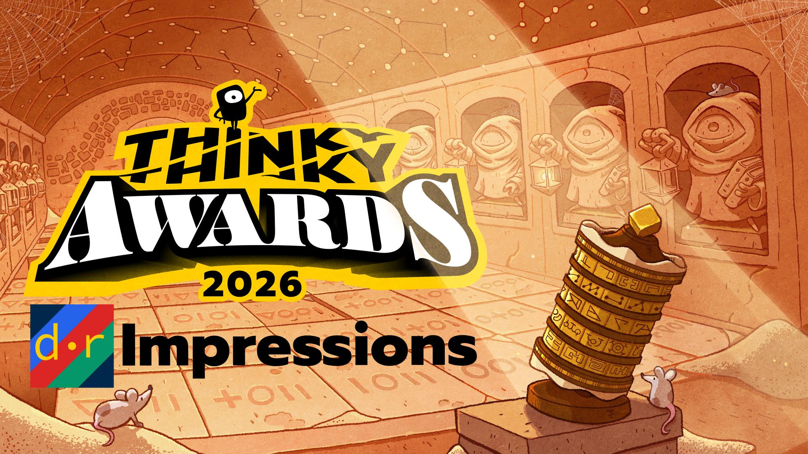

It's still 2026, but I think there's time for [one more](/articles/thinky-awards-2025-impressions/) [Thinky Games](https://thinkygames.com/) awards post before we hit the new year. No, you're not seeing double; the awards have shifted from January to November, so peak puzzle Christmas has literally come early!

I'm lucky enough to be a juror for the third year running. I've spent the past week trying out some of the best thinky games released this year and I'm excited to write about my time with them. I only get so much time with each title, but I try to play enough to produce an informed opinion.

> Where relevant, reviews are scored [out of 4](/rating/games/).

Here are all the nominees I've played, in alphabetical order:

## 20 More, Somehow Even Smaller, Mazes

<ThinkyImpression
  playSlug="20-more-somehow-even-smaller-mazes"
  steamId="4428890"
>

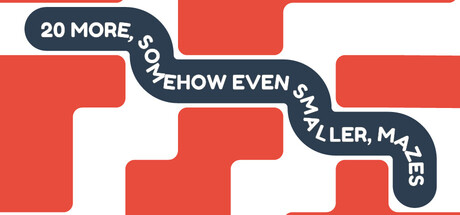

</ThinkyImpression>

## 868-BACK

<ThinkyImpression
  verdict="I am drawn to it, but discouraged by its difficulty. TBD"
  steamId="3304110"
>

I liked that the gameplay itself is simple but there's a _lot_ of strategic depth at play. Each run is made of many smaller runs, so there's constant variation, too. The art has a chaotic hacker energy that I generally enjoyed, but its commitment to the bit hurt legibility a little. Enemies are "tasks", abilities are "progs", passive abilities are "devs", etc. It's a cool vibe, but deciphering and evaluating options would take a lot of practice.

Over ~6 (brief) runs, I got wiped out early every time. It was probably me playing too quickly and impulsively, but I also get the sense that real progression here would take a lot of time. ... That said, I ended every run wanting immediately wanting to try again, so there may just be something here. Time will tell, I guess.

</ThinkyImpression>

## A Little Perspective

<ThinkyImpression
  verdict="Appreciated it for what it was, but unlikely to revisit"
  steamId="3485300"
>

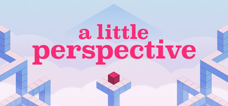

My initial impression was very good: the art is pleasant, there's a story told through a voiceover, and it's Escher-like premise is both interesting and immediately apparent. Sort of like [Monument Valley](/games/monument-valley-iii/), but actually hard.

Unfortunately, I found the puzzles themselves a little obtuse. Solving a puzzle relies on a firm understanding of how your perspective affects where/how you can move. But try as I might, I wasn't able to form a consistent set of rules for what was possible. I solved a few puzzles by accident when I made what seemed like it should have been an impossible move, which wasn't satisfying.

That said, even in my short time playing it, it pulls a few cheeky little tricks. So it seems clever and lovingly crafted, but maybe not for me.

</ThinkyImpression>

## The Art of Reflection

<ThinkyImpression
  verdict="Mind bending, but not really my style."
  steamId="2290770"
>

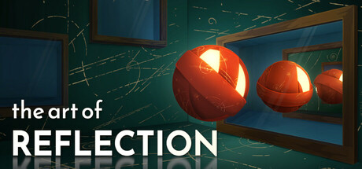

I appreciated what the game was putting down, but I find that pure puzzlers aren't really my style these days. I liked that there was some timing required for some sections though. The teleportation mechanic was unique and the mirror stuff & shifting gravity got mind-bending quickly. The music was good too! It's well-made, just not something I'll spend a lot of time with.

</ThinkyImpression>

## The Artisan of Glimmith

<ThinkyImpression
  verdict="Simple, yet compelling. Will play slowly."
  steamId="4160210"
>

A beautifully, cozy little spatial puzzle game. The stained glass theme is brilliant, even if I didn't engage much with the custom colors. It plays almost like a "rules discovery" game (even though it's not; every mechanic is accompanied by a tutorial). The variety of rules set it apart from games like [last year's Nurikabe World](/articles/thinky-awards-2025-impressions/#nurikabe-world), which felt much more repetitive (if just as nicely presented).

The scrolling overworld is an interesting approach. It lets the puzzle breathe a bit, further helping the nonstop puzzle solving that many of its contemporaries suffer from.

I was a little underwhelmed by the controller support. It definitely _worked_, but it's just a way to drive the cursor. It's a keyboard/mouse game at heart.

</ThinkyImpression>

## Big Walk

<ThinkyImpression
  verdict="Currently playing and loving it!"
  steamId="1478500"
>

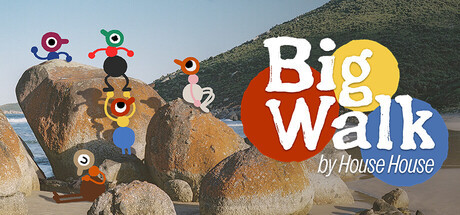

I'm currently partway through a _Big Walk_ with 2 friends, but early impressions have been _very_ positive. It's unerringly pleasant and so full of life. The sound design is perfect and it's leisurely pace fits the relaxed atmosphere of the game so well. Communication as a gameplay mechanic is just fun and it creates such an engaging, human experience. A total triumph of game design.

</ThinkyImpression>

## Burn With Me

<ThinkyImpression
  articleSlug="burn-with-me-review"
  steamId="2954010"
>

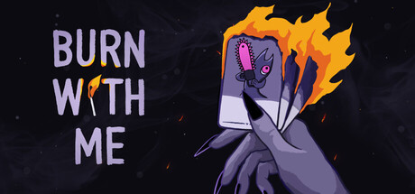

</ThinkyImpression>

## Colorbound

<ThinkyImpression
  verdict="Charming! Will likely revisit"
  steamId="3778610"
>

A cute little puzzle platformer. Its presentation reminded me a lot of [Carto](/games/carto/), which is high praise. The puzzles were strong and there's an _excellent_ hint system that drip-feeds you steps to get you unblocked. The puzzles are easy to explain, but hard enough that you have to actually consider your moves if you don't want to end up backed into a corner. Strong story with a good sense of place, too; there aren't many (any?) South American games, so it's a fun change of pace!

</ThinkyImpression>

## Deductopia

<ThinkyImpression
  verdict="Right up my alley; will finish it soon."
  steamId="4429720"
>

It's [Golden Idol](/games/the-rise-of-the-golden-idol/), but for playground-level mishaps instead of supernatural murder. The UI is pretty clean and the puzzles aren't too tough. I found the art style a little rough around the edges, but it's a well built experience overall. I'll basically never turn down a well made Idol-like!

</ThinkyImpression>

## EMUUROM

<ThinkyImpression
  verdict="Interesting, but not for me"
  steamId="1634360"
>

A clear descendent of the [Animal Well](/games/animal-well/) school of puzzle platformers with many secrets. But despite loving its predecessor, _EMUUROM_ didn't do it for me. Part of it was the stripped-down art style, which made legibility tough. The platforming didn't feel especially good either, which hurt when that's what you're doing a lot of. It didn't feel especially precise, though I expect it's much deeper than I understood while I played.

Scanning flora and fauna to learn how they interact with the world is a great concept. But unfortunately, the actual execution just didn't click for me.

</ThinkyImpression>

## Hamstermind

<ThinkyImpression
  articleSlug="hamstermind-review"
  steamId="3555520"
>

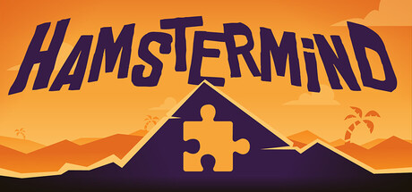

</ThinkyImpression>

## He Who Watches

<ThinkyImpression
  articleSlug="he-who-watches-review"
  steamId="1070500"
>

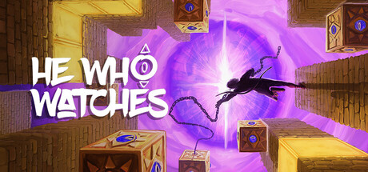

</ThinkyImpression>

## Horse Magnifier

<ThinkyImpression
  verdict="Didn't hold my attention, won't revisit."
  steamId="4585340"
>

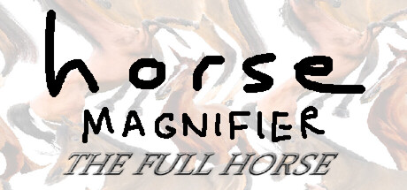

This is a very funny concept for a game but lost its luster after about 10 levels. It's cute, but didn't really feel like it had legs. That said, I _am_ morbidly curious about what jump scares the game has (though not enough to turn them on and find out).

</ThinkyImpression>

## The Incident at Galley House

<ThinkyImpression
  articleSlug="galley-house-review"
  steamId="3641000"
>

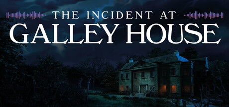

</ThinkyImpression>

## Map Map

<ThinkyImpression
  articleSlug="map-map-review"
  steamId="2702260"
>

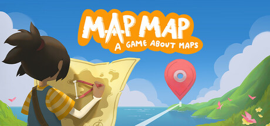

</ThinkyImpression>

## The Mermaid Mask

<ThinkyImpression
  verdict="Definitely going to keep playing"
  steamId="1696770"
>

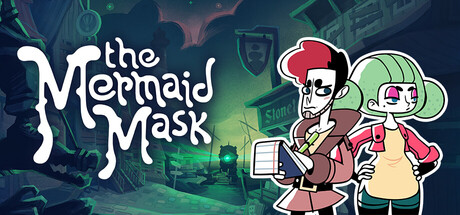

A narrative murder mystery with (simple so far) puzzles, executed well. UI is smooth and the characters are memorable. The full voice acting is a nice touch too. Everyone is appropriately cartoonish and the art direction is excellent overall. And it's a locked-door mystery!

</ThinkyImpression>

## The Message from Deep Space

<ThinkyImpression
  verdict="Pulled me in quickly. Definitely going to play more."
  steamId="4080030"
>

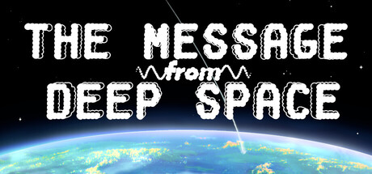

It gives strong [Chants of Sennar](/games/chants-of-sennaar/) crossed with [Contact](/movies/contact-1997/), where you iteratively decode an unfamiliar language using mathematical fundamentals (and more!). I've heard it gets much harder, but the difficulty curve has been pretty smooth through the first few chapters.

The UI chrome is nicely designed and fits the 70s computer vibe well. There's a pleasant amount of story and I appreciated that it permeated the whole experience rather than feeling bolted on. It's a simple concept well executed and I am on board!

</ThinkyImpression>

## Opus Magnum: De Re Metallica

<ThinkyImpression
  verdict="Will definitely play when I have the time"
  steamId="3107410"
>

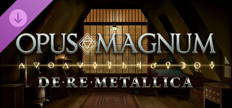

Given that [Opus Magnum](/games/opus-magnum/) is one of my all time favorites, it should come as no surprise that I really enjoyed (what I played of) this surprise DLC. There are some neat new mechanics, but it's mostly more of the same. But when the same is so good, you can't really ask for much more.

</ThinkyImpression>

## Order of the Sinking Star

<ThinkyImpression
  verdict="Will probably play some more, but can't imagine I'll finish it"
  steamId="499170"
>

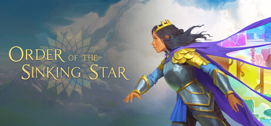

_OotSS_ has a lot going for it: a surprising amount of narrative, a metric tonne of puzzles, and nice art direction. The puzzles were tightly designed and each had something to teach or prove. As an adaptation of 4 other games, it works well. I didn't make it far enough to see any mechanic mixing between areas, but I imagine that'll be pretty cool.

I enjoyed each of the starting areas, but found some of the mechanics in the east and south a little tricky for my taste. I appreciated that I could wander elsewhere when I got stuck, but I'm not sure how long I'd stick with it. [HTLB](https://howlongtobeat.com/game/178931) records 40 hours to reach an ending and more than 130 hours to 100%... which is too many hours. I usually don't have the patience for that sort of thing.

Definitely a great game for puzzle sickos though!

</ThinkyImpression>

## Phonopolis

<ThinkyImpression
  verdict="Will definitely finish!"
  steamId="1206070"
>

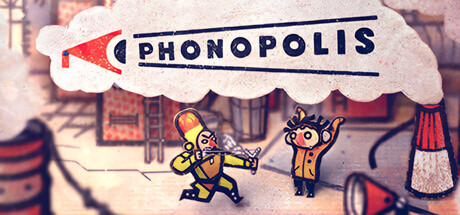

A fun little audio-based dystopia. The animations are phenomenal, but I'd expect nothing less from the team behind [Machinarium](/games/machinarium/). It feels like a playable [Laika](https://en.wikipedia.org/wiki/Laika,_LLC) movie.

The puzzles are simple, but fun. The whole thing feel smore comedic than thinky, which is a fun change of pace.

</ThinkyImpression>

## Schrodinger's Cat Burglar

<ThinkyImpression
  verdict="Very cute! Will revisit."
  steamId="2111550"
>

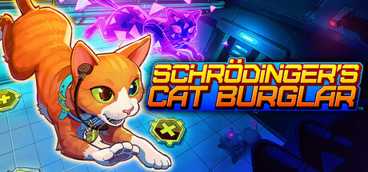

A nicely-polished game about a cat burglar who can be in two places at once. The story was light, but charmed me out of the gate. The puzzles were pretty straightforward (which tracks- it's nominated for _Best Accessible Game_) but I suspect they'll get harder. Held items being temporarily duplicated between cats seems like a pretty deep vein to pull from.

Controlling both cats at once reminded me of [Semispheres](/games/semispheres/), which is always a good thing. I'll be curious to see how they push that mechanic, since that particular strand of mental strain is both fun and unusual.

I also appreciated the co-op support, which is a rarity in puzzle games. Probably less antagonistic than co-op favorite [Death Squared](/games/death-squared/), but you never know!

</ThinkyImpression>

## Shroom and Gloom

<ThinkyImpression
  verdict="Will give it a go once it's out of early access"
  steamId="3271280"
>

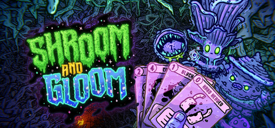

A refreshing take on the roguelike deckbuilder formula. There's no defense, but there's a _lot_ of healing. You can permanently modify cards, which leads to some pretty goofy combos. And you're managing two decks at once: one for combat and once for between rooms. It's a neat concept that works well.

There's basically no downtime though, so my runs took a fair amount of focus. The art style isn't really for me (too gooey) but it's certainly supported by a strong vision. I'll be curious to see what else they add during the early access period!

</ThinkyImpression>

## The Red Pearls of Borneo

<ThinkyImpression
  playSlug="the-red-pearls-of-borneo"
  steamId="4488860"
>

When I played _Borneo_ earlier this year, I wrote:

  And luckily, a sequel is on the way! [Green Mist Over
  Portland](https://store.steampowered.com/app/4644870/Green_Mist_over_Portland/)
  is in active development. I've already confirmed that the developer has shored
  up my major complaints about *Red Pearls*, so I imagine I'll have little to
  complain about.

</ThinkyImpression>

## The Remake of the End of the Greatest RPG of All Time

<ThinkyImpression
  verdict="Absolutely going to play, I need to see where it goes"
  steamId="2809660"
>

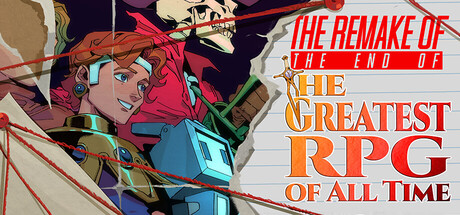

Taking the award for both highest concept and longest name, _TRotEotGRPGoAT_ is a total trip. You jump into the last hour of a remastered version of a thin pastiche of [Chrono Trigger](https://en.wikipedia.org/wiki/Chrono_Trigger). You don't have any context, but you're max level and have tons of items already, because the save file you're using is already at the end of the game. You're soon puzzling your way through the enigmatic end-game combat and references to the adventure you must have had to have gotten here.

There are also interstitial segments where you wander around a virtual world outside the game, solving more puzzles and watching clips from the documentary that's being made about the development of the game that you've been playing. There's also pages of the game's manual to find (a la [Tunic](games/tunic/)), cluing you in about how the game works.

The puzzles are straightforward so far, but the experience is wild. It's all mad brilliance and I am absolutely here for it.

</ThinkyImpression>

## TRACE: SHAPE

<ThinkyImpression
  verdict="Will definitely finish (and play the base game too)"
  steamId="3448760"
>

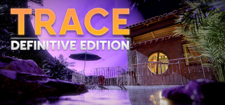

TRACE (and its expansion, SHAPE) are both escape-room style point-and-click games set in an uncanny little sci-fi planet. The puzzles were approachable and the art direction is excellent. Everything feels tactile, which is good when you're exploring and poking at things. As a dedicated escape room veteran, this is right up my alley.

</ThinkyImpression>

## Titanium Court

<ThinkyImpression
  verdict="Bizarre and unique. Must see more."
  steamId="2364580"
>

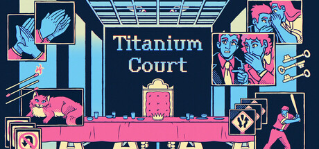

I heard a lot of buzz about this one when the IGF awards were happening last year and boy did it deliver. It's a match-3 / resource management / auto-battler / rogue-like all tied together with some _stunningly_ written dialogue and meta-narrative.

The actual match-3 / combat gameplay is reasonably strategic without being too pushing. But I'm absolutely hooked on everything else surrounding the core gameplay. I know I'll need to see this one through.

</ThinkyImpression>

## TR-49

<ThinkyImpression
  verdict="Interesting concept that I'm excited to see through to the end."
  steamId="3838370"
>

A document discovery game in the vein of [Galley House](#the-incident-at-galley-house), which is right up my alley. It took a few minutes to wrap my head around what was going on, but I was sold on it once I got my feet under me.

There are a lot of layers of narrative happening, but it rewards players who can absorb everything. I loved that the game records important information as you go, saving me the trouble of determining the importance of every snippet. It's convenient, but threatens to streamline the experience a little too much. Sometimes that's what the doctor ordered though.

The production value is through the roof, with full voice acting and fluid animations. Story is a little slow, but I'm interested enough to see where it'll go. [Inkle](https://www.inklestudios.com/), the developer, has put out consistently good work, so I'm confident they'll stick the landing.

</ThinkyImpression>

## That's all for now

What a year! The competition is stiff as always, but I'm happy with my picks. Congrats to all the nominees and thanks again to the Thinky Games folks. Until next year!

<SubscribeBlurb
  blurb="To be notified about new reviews and articles, consider subscribing via"
  showSteamButton
  centered
/>
